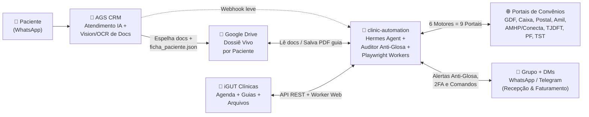

# 🏥 AEGIS Clinic Automation (`clinic-automation`)

> **Plataforma autônoma multi-setorial e multi-clínica da AEGIS Tecnologia** baseada em **Hermes Agent + Playwright Workers + Auditoria Anti-Glosa Multimodal**, integrada de forma **100% desacoplada** ao **AGS CRM**, **Google Drive** e **iGUT Clínicas**.

---

## 🎯 Propósito do Projeto

Automatizar rotinas operacionais complexas de clínicas médicas que hoje consomem horas diárias de trabalho manual — começando pela **Fase 1: Emissão Automática de Guias de Convênios (TISS / SP-SADT) + Auditoria Anti-Glosa + Fechamento no Prontuário iGUT** na **Clínica Nova Gesta**, mas desenhada desde o Dia 1 no padrão **`Core Reutilizável + Tenant Packs`** para replicação rápida em novas clínicas clientes.



---

## 📚 Mapa da Documentação Arquitetural

| Documento | O que você encontra lá |
| :--- | :--- |
| **[01 — Arquitetura e Matriz "O que faz o quê"](docs/01-arquitetura-e-responsabilidades.md)** | Topologia completa do ecossistema, fronteiras claras de responsabilidade entre **AGS CRM**, **Google Drive**, **iGUT**, **Hermes Agent**, **Playwright Workers** e **Equipe Humana**, além da infraestrutura da VPS Hostinger. |
| **[02 — Fluxos Operacionais e Diagramas](docs/02-fluxos-e-diagramas.md)** | Diagramas de sequência, fluxograma ponta a ponta da emissão de guias com barreira Anti-Glosa, máquina de estados dos jobs (`GuideJob`) e fluxos de interação no Grupo/DM WhatsApp & Telegram. |
| **[03 — Contrato Google Drive ⇄ AGS CRM ⇄ Hermes](docs/03-contrato-google-drive-e-crm.md)** | Estrutura oficial de pastas por paciente no Google Drive, schema completo do `ficha_paciente.json`, contrato de webhooks assíncronos e estratégia multi-tenant de autenticação Google (Service Account / OAuth). |
| **[04 — Catálogo dos 6 Motores = 9 Portais + iGUT](docs/04-catalogo-motores-e-portais.md)** | Blueprint técnico dos 9 portais mapeados da Nova Gesta, tabela de códigos por operadora, regras anti-bloqueio (AMHP) e ritual obrigatório de fechamento em 3 passos no iGUT. |
| **[05 — Estrutura do Repositório e Roadmap](docs/05-estrutura-repo-e-roadmap.md)** | Organização de código (`core/` + `tenants/`), stack tecnológica e plano de execução sprint a sprint (da integração Drive no AGS CRM até a operação autônoma). |

---

## 🧱 Princípios Inegociáveis da Arquitetura

1. **Desacoplamento Total do AGS CRM**: O `clinic-automation` roda em servidor próprio (**VPS Hostinger Ubuntu 24.04 — Datacenter Brasil**) e conversa com o AGS CRM apenas via **Google Drive compartilhado** e **Webhooks/REST**. Uma falha em portal de convênio jamais afeta o WhatsApp de atendimento da clínica.
2. **IA Operando o Navegador + Monitoramento Contínuo de Aprovação**:
   - **Browser AI Agent (`core/agent/browser_ai_agent.py`)** = observa a página em tempo real (DOM + texto + HUD visual), decide cada clique/preenchimento/upload (via OpenAI GPT-4o, Gemini Flash ou planejador semântico local), submete a guia e **permanece acompanhando** o status `EM ANÁLISE` até sair `AUTORIZADA` (baixando o PDF) ou `NEGADA`.
   - **Guardrails Rígidos** = nunca clica em *"Esqueci minha senha"* e pausa imediatamente (`AWAITING_HUMAN_2FA`) caso surja CAPTCHA ou 2FA.
3. **Barreira Anti-Glosa Antes de Abrir Qualquer Portal**: Carteirinha vencida, pedido sem assinatura/carimbo/CRM ou exame sem código TUSS trava a emissão **antes** de bater no portal e dispara alerta imediato no grupo da clínica.
4. **Replicabilidade Multi-Clínica (`Core + Tenant Pack`)**: Os conectores, auditor Anti-Glosa e o agente IA de navegador pertencem ao `core/`. Cada nova clínica adiciona apenas seu diretório em `tenants/<clinica>/` com constantes, portais, tabela TUSS/médicos e credenciais isoladas.
5. **Zero Segredos no Git**: Senhas de portais, JSONs de Service Account e cookies de sessão (`storage_state/`) nunca são versionados (protegidos por `.gitignore` e `.env` com permissão `chmod 600` na VPS).

---

## 🚀 Como Rodar Localmente (Sprint 1)

```powershell
# 1. Instalar dependências e Chromium (dentro do .venv)
.\.venv\Scripts\pip.exe install -r requirements.txt
.\.venv\Scripts\playwright.exe install chromium

# 2. Rodar toda a suíte automatizada (inclui teste E2E real no Chromium!)
.\.venv\Scripts\python.exe -m pytest -v

# 3. Subir a API FastAPI + Portal Simulador TISS (/mock-portal)
.\.venv\Scripts\uvicorn.exe core.api.app:app --reload --port 8000

# 4. Assistir a demonstração VISUAL AO VIVO na tela (IA clicando, preenchendo e aguardando aprovação!)
.\.venv\Scripts\python.exe scripts\demo_visual_guia.py --delay 6 --outcome authorized
```
