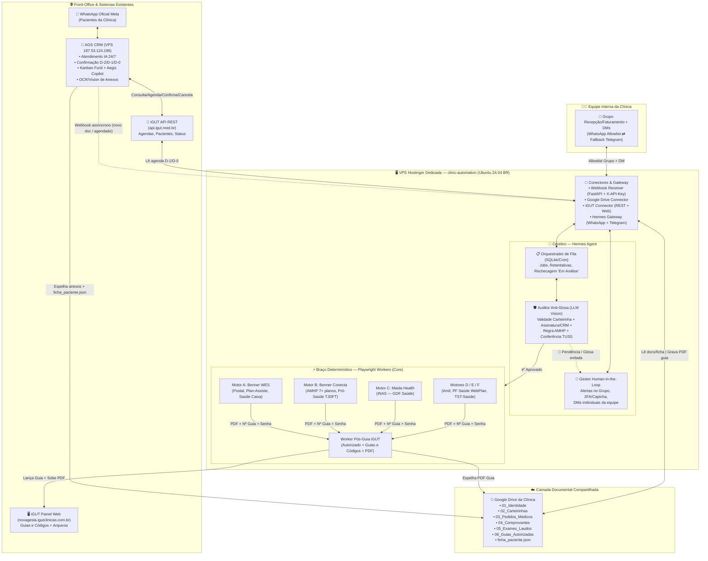

# 01 — Arquitetura do Ecossistema e Matriz "O que faz o quê"

Este documento define as fronteiras exatas entre todos os sistemas que compõem a automação da clínica, garantindo **zero duplicação de responsabilidade**, **desacoplamento limpo** e **replicabilidade multi-clínica**.

---

## 1. Visão Macro da Arquitetura

---

## 2. Matriz "O que faz o quê" (Separação Clara de Papéis)

| Componente | ✅ O que ELE FAZ (Responsabilidade Exclusiva) | ❌ O que ele NÃO faz |
| :--- | :--- | :--- |
| **1. AGS CRM** *(Backend NestJS — `Ags-Crm`)* | • Atende pacientes no WhatsApp oficial (Meta Cloud API) com IA humanizada. • Agenda, confirma e desmarca consultas via API REST do iGUT. • Gerencia o funil Kanban (`Agendado no iGUT`, `Aguardando encaixe`, `Desmarcado/Cancelado`) e o Aegis Copilot. • Recebe anexos do paciente, classifica via Vision/OCR (`carteirinha_convenio`, `documento_identidade`, `pedido_medico`, `comprovante_pagamento`) e extrai campos básicos. • **Espelha automaticamente** esses arquivos + `ficha_paciente.json` no **Google Drive** da empresa. • Opcionalmente dispara webhook leve notificando o `clinic-automation` que um novo documento/agendamento chegou. | • **Não** abre navegadores/Playwright. • **Não** acessa portais de convênios. • **Não** armazena senhas de portais de planos de saúde. • **Não** executa lógica de faturamento/TISS/TUSS. |
| **2. Google Drive** *(Pasta Compartilhada da Clínica)* | • Funciona como **dossiê documental vivo e permanente por paciente**. • Desacopla o AGS CRM do `clinic-automation` (mesmo que um servidor reinicie, os documentos permanecem íntegros e acessíveis). • Mantém `ficha_paciente.json` estruturado para leitura instantânea sem reprocessar OCR. • Guarda os PDFs das guias autorizadas (`06_Guias_Autorizadas/`) para consulta humana e auditoria futura. | • **Não** executa automações nem regras de negócio — é puramente a camada de armazenamento compartilhado e auditável. |
| **3. iGUT Clínicas** *(API REST + Painel Web)* | • Fonte oficial da **agenda médica**, cadastro de pacientes, profissionais e convênios. • Repositório oficial onde o faturamento exige o fechamento: status `Autorizado`, dados em `Guias e Códigos` e PDF em `Arquivos e Imagens -> ARQUIVOS`. | • Não conversa com os portais de convênios nem audita documentos de glosa. |
| **4. Hermes Agent — Orquestrador** *(Cérebro no `clinic-automation`)* | • Monitora a agenda D-1 / D-0 do iGUT via cron e recebe webhooks do AGS CRM ou comandos manuais da equipe. • Mantém a fila persistente de jobs (`SQLite`) com estado, tentativas, logs e rechecagem automática de guias `"Em Análise"`. • Decide qual motor e qual tabela de códigos aplicar conforme convênio, especialidade e credenciamento (Direto vs AMHP). • Gerencia a conversa interna no **Grupo da Clínica** e **DMs autorizadas** (WhatsApp com fallback instantâneo para Telegram). | • **Não** conversa diretamente com pacientes externos no WhatsApp da clínica (isso é papel exclusivo do AGS CRM). |
| **5. Auditor Anti-Glosa** *(Skill Multimodal no Hermes)* | • Roda **antes** de qualquer emissão de guia. • Valida no dossiê do Drive: existência e **validade da carteirinha**, **assinatura + carimbo/CRM + data válida no pedido médico**, consistência de CPF/Nome e mapeamento de código TUSS/operadora. • Se houver risco de glosa, **bloqueia a emissão** e envia alerta objetivo no Grupo da clínica informando exatamente o que falta atualizar. | • **Não** aprova guias com dados faltando nem "chuta" códigos TUSS inexistentes. |
| **6. Agente Executor de Portais (IA + Browser)** *(Braço Inteligente — `core/workers/` + Hermes)* | • Utiliza **IA operando o navegador real (Playwright/Chromium)** com skills específicas por convênio para executar as ações humanas de preenchimento, anexo de pedido e emissão da guia nos 9 portais. • Fica monitorando continuamente as guias enviadas (rechecagem de status `"Em Análise"` até `"Autorizada"` ou `"Negada"`), baixando o PDF oficial e extraindo `Nº Guia`, `Senha` e `Validade`. • Em caso de Captcha/2FA ou erro de login, pausa e pede ajuda humana no grupo (jamais aciona "Esqueci minha senha"). | • **Não** altera senhas de portais (regra AMHP) e **não** inventa dados fora do dossiê validado. |
| **7. Worker Pós-Guia iGUT** *(Fechamento no `core/connectors/igut_web/`)* | • Após a guia ser autorizada no portal do convênio, executa o fechamento padronizado em 3 passos no iGUT Web: marcar `Autorizado`, preencher `Guias e Códigos` e subir o PDF em `ARQUIVOS` no padrão `AUT CONSULTA/EXAME - DRA <MEDICO> (<DD/MM>)`. | • **Não** altera horários, médicos ou desmarca agendamentos. |
| **8. Equipe Humana da Clínica** *(Recepção / Faturamento no Grupo & DM)* | • Resolve exceções reais: solicita carteirinha nova ou pedido assinado à paciente quando o Auditor Anti-Glosa alerta. • Resolve pontualmente 2FA/Captcha quando um portal exigir. • Pode dar comandos sob demanda ao Hermes no Grupo ou DM (ex.: *"Hermes, reemite a guia da Maria no GDF Saúde"*). • Acompanha o relatório consolidado diário de guias emitidas. | • **Não** perde mais horas digitando manualmente os mesmos campos em 9 portais diferentes e subindo PDF um por um no iGUT. |

---

## 3. Arquitetura Replicável Multi-Clínica (`Core + Tenant Pack`)

O `clinic-automation` é separado em duas camadas:

1. **`core/` (Motor AEGIS — Reutilizável 100%)**:
   - Motores de portais (`BennerWesWorker`, `BennerConectaWorker`, `MaidaGdfWorker`, `AmilWorker`, `WebPlanWorker`, `TstSaudeWorker`).
   - Conector Google Drive + leitor/escritor de `ficha_paciente.json`.
   - Conector iGUT (API REST + Worker Web Pós-Guia).
   - Auditor Anti-Glosa e Orquestrador de Jobs SQLite.
   - Gateway de Notificações (WhatsApp / Telegram) + Webhook Receiver do AGS CRM.
2. **`tenants/<slug>/` (Pacote Específico da Clínica — ex.: `tenants/nova-gesta/`)**:
   - `config.json`: CNPJ, Razão Social, códigos de prestador (Direto vs AMHP), unidades e horários de cron.
   - `doctors.json`: CRM, UF, CBO e especialidades do corpo clínico.
   - `procedures_map.json`: tabela de códigos TUSS e códigos proprietários por operadora/especialidade.
   - `portals.json`: mapeamento de qual convênio usa qual Motor (`core/workers/`) e URL.
   - `.env` *(apenas na VPS, nunca no Git)*: credenciais dos portais, tokens iGUT, Service Account do Drive e `X-API-Key` do AGS CRM.

> **Resultado**: para implantar em uma 2ª clínica (ex.: Tesla Imagem ou nova clínica cliente da AEGIS), basta criar `tenants/<nova-clinica>/` com as configurações dela e subir um container/VPS apontando `TENANT_ID=<nova-clinica>`.

---

## 4. Topologia de Servidores (Isolamento de Produção)

| Servidor | Hospedagem / Spec | O que roda lá | Por que separado? |
| :--- | :--- | :--- | :--- |
| **VPS 1 — AGS CRM** *(Já em produção)* | Hostinger (`187.53.124.196`) | `crm_api`, `crm_client`, `crm-postgres`, `crm-redis`, `waha_api`, `crm_caddy` | Mantém o atendimento WhatsApp 24/7 leve, estável e imune ao consumo de RAM de navegadores Chromium/Playwright. |
| **VPS 2 — `clinic-automation`** *(Dedicada Nova Gesta)* | **Hostinger KVM 2 — Ubuntu 24.04 LTS — Datacenter Brasil (SP)** `2 vCPU` · `8 GB RAM` · `100 GB NVMe` | `hermes-agent`, `clinic-automation-api` (FastAPI), `playwright-workers` (Chromium), `SQLite` (volume persistente), `Caddy SSL` | **IP Brasileiro** evita bloqueio/Captcha em portais governamentais (`caixa.gov.br`, `tst.jus.br`, `tjdft.jus.br`, `gdf.maida.health`) e isola 100% os dados/credenciais da clínica. |
