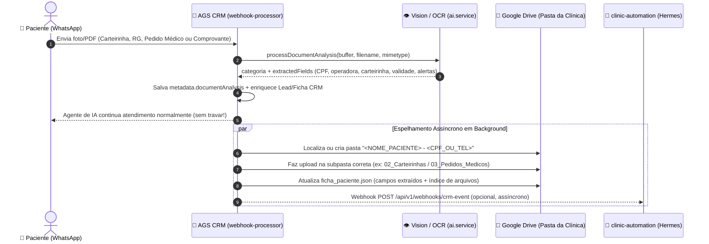
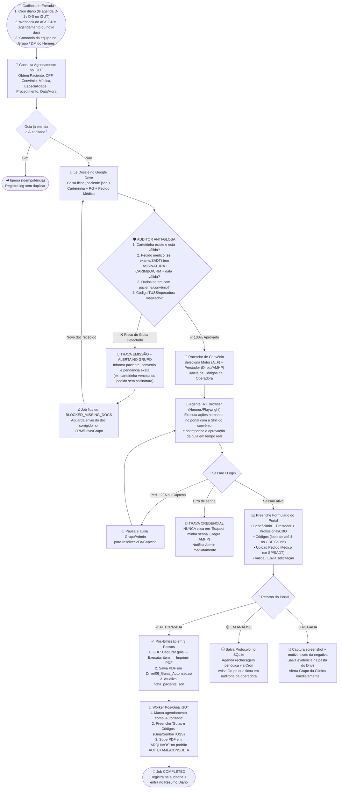
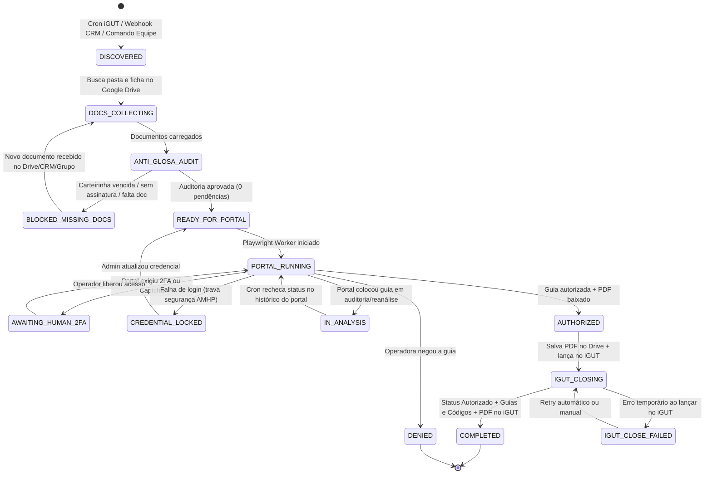
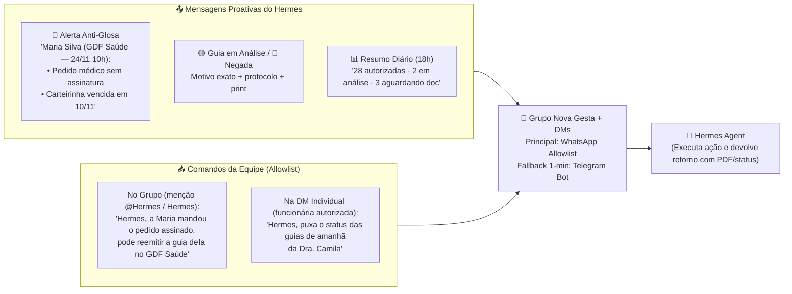

# 02 — Fluxos Operacionais e Diagramas

Este documento detalha visualmente **como os dados e documentos trafegam de ponta a ponta**, desde o momento em que o paciente envia uma foto no WhatsApp até a guia autorizada estar salva no Google Drive e lançada no iGUT.

---

## 1. Fluxo 1 — Captura de Documentos no AGS CRM → Espelhamento no Google Drive

> **Ponto-chave**: O upload para o Google Drive roda **em background (non-blocking)** após a análise do anexo no AGS CRM. Se a API do Google oscilar por 5 segundos, o atendimento do paciente no WhatsApp não sofre atraso algum e uma fila/retry garante o espelhamento.

---

## 2. Fluxo 2 — Emissão de Guia com Barreira Anti-Glosa (Ponta a Ponta)

---

## 3. Fluxo 3 — Máquina de Estados de um `GuideJob` (SQLite)

Todo pedido de emissão de guia possui rastreabilidade completa e idempotência pela chave `(tenant_id, igut_appointment_id, procedure_batch_index)`:

---

## 4. Fluxo 4 — Operação Humana no Grupo & DMs (WhatsApp / Telegram)

---

## 5. Modo de Operação Progressivo (Segurança na Implantação)

Para garantir **confiança total da equipe** antes de deixar 100% autônomo:

1. **Modo Sombra / Auditoria (`SHADOW`)**: Lê agenda iGUT + Drive, roda o **Auditor Anti-Glosa** e reporta pendências no grupo, sem submeter nada nos portais ainda.
2. **Modo Assistido (`ASSISTED`)**: Emite a guia no portal (ou prepara tudo) e envia o PDF + números no Grupo para conferência rápida antes ou logo após lançar no iGUT.
3. **Modo Autônomo (`AUTONOMOUS`)**: Emite, salva no Drive, fecha no iGUT e envia apenas exceções (glosas evitadas / negativas / 2FA) + o resumo consolidado do dia.
